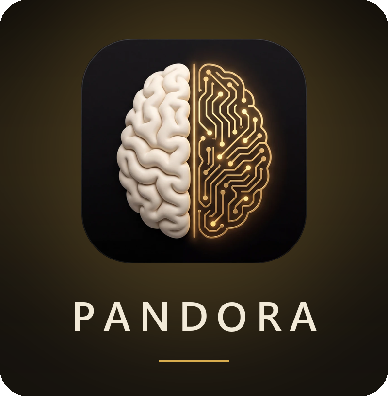

<p align="center">
  
</p>

<p align="center">
  <b>From the written page to generated, edited shots — one free, open-source studio for Windows and macOS.</b>
</p>

<p align="center">
  <a href="LICENSE"></a>
  
  
</p>

---

## Presentation

**PANDORA** is an AI pre-production and generation studio. Write or import a
screenplay, and PANDORA turns it into a shot breakdown, a storyboard, a cast, sets
and props — then generates every shot with the AI engine of your choice, on a cloud
service you pay per use, on your own computer, or across all your machines with
**AIODOS**. No subscription, no lock-in: your projects stay on your disk.

**Two editions, one install**

- **Cinema** — films, series, commercials: screenplay → breakdown → storyboard → AI shots → edit.
- **Live** — VJ loops and projection mapping on building facades, cut to the tempo of your music set.

### From the page to the shot

- **Writes with you** — Claude, your ChatGPT Plus / Pro account or a local AI formats, analyses and co-writes the screenplay; nothing changes without your approval.
- **Breaks it down** — a shot-by-shot breakdown that keeps your story, then a storyboard where each shot carries its size, camera move, lens, duration and a final prompt written for the target engine.
- **Shows the film before you shoot it** — character portraits, set images, a mood image per shot, a 3D scene with its lighting; these images travel with each shot to keep the same faces and places from one shot to the next.
- **Generates the shots** — Seedance 2.0 / 2.5 (up to 30 s), Kling, Veo, Sora, Wan, MiniMax, PixVerse and more in the cloud, or free on your own hardware with ComfyUI: one « ComfyUI » entry, its AI engines grouped by model family and ranked from the strongest on the market to the lightest.
- **Pays less for the same engine** — Seedance through fal.ai, BytePlus (ByteDance's official seller), Runware or PiAPI, in the priority order you choose.
- **Hands over to the edit** — each clip lands, as it is generated, in **DaVinci Resolve** or **FilmCraft** (the ArtCraft suite's editor), named by sequence, shot and take; the storyboard cuts itself into a timeline there, or exports as XML for any other editor.
- **Keeps the bill visible** — every paid operation is logged in the project's cost report.

### Your machines, together — AIODOS

**AIODOS** (by 22eme Arkane) pools the computing power of your machines: this PC,
your other computers, and soon other people's over the Internet. PANDORA speaks to
it directly:

- **Compute anywhere** — the « Compute » menu of every ComfyUI engine offers *This
  PC*, *My machines · AIODOS* or *Public network · AIODOS*. The same image and video
  templates are split across the machines that have the models; when the public
  network is enabled in the AIODOS tab, it becomes the default.
- **A text AI that costs nothing** — AIODOS's chat models can write and translate
  PANDORA's prompts instead of a paid API.
- **See who computes** — an *AIODOS* tab lists the connected machines and the
  running jobs (pause, resume, cancel, retry); in the AI Studio, a panel opens by
  itself when machines connect, like the peers of a BitTorrent client.
- **Your references stay home** — a reference image or a clip is only ever computed
  on this PC and your own machines, never by friends or the public network. Access
  is granted in AIODOS with a code, on a click, never at startup.

Not installed yet? The AIODOS tab presents it and links to its download.

### Speak instead of typing — ORAKLE

Every text field carries a small microphone: click, speak, click again, the text
is written at the cursor. ORAKLE's shortcuts work too — **hold Ctrl+1** to talk,
**Ctrl+1 twice** for hands-free. Speech is transcribed **on your computer**
(Whisper), in French, English or Spanish; if ORAKLE is installed, its dictionary
and model are shared.

### Make it yours

Three appearances — **Black** (default), **Night blue** and **Light** — in Settings,
a bilingual interface (French / English), a second window for a second screen, and
each version's news shown right inside the application.

---

## Download

**[⬇ Download PANDORA v2.7.0 for Windows](https://github.com/22eme-Arkane/PANDORA/releases/download/v2.7.0/PANDORA_Setup_2.7.0.exe)**

**[⬇ Download PANDORA v2.7.0 for macOS](https://github.com/22eme-Arkane/PANDORA/releases/download/v2.7.0/PANDORA_2.7.0.dmg)** *(Apple Silicon — see [Installation](#installation) for the first launch)*

All versions: [Releases](../../releases)

🌐 **Official 22eme ARKANE website: [22eme-arkane.com](https://22eme-arkane.com)**

---

## What's new in v2.7.0

**A 3D scene for every shot, PANDORA in black, ORAKLE's voice dictation in every
field, a new logo, your own machines to compute — and each version's news right
inside PANDORA.**

- **A 3D tab for every shot.** Lights, set, furniture, characters and camera at real
  scale, in ARKLIGHT's 3D view: real lights with their simulated front panels and
  menus, jointed characters with over 40 actions. **Every element has its own
  keyframes**: a character walks, throws a punch, then runs; the camera travels,
  rises on its stand, tilts. Everything is read as text for the prompt, written to
  the storyboard when you ask for it. The shot can be exported as a video and sent
  to Seedance as a motion reference (optional, up to 30 s with Seedance 2.5), and
  an AI can stage the shot from a written description.
- **PANDORA opens in black.** The new **Black** theme keeps PANDORA's colours
  (turquoise, violet) on a black background, start page included. Settings →
  General → Appearance offers a drop-down menu with a preview of each theme:
  **Black**, **Night blue** (the original dark blue) and **Light**. The chosen
  theme applies on restart, and PANDORA offers to restart right away.
- **ORAKLE's voice dictation.** A small microphone appears in the fields you type
  in: click, speak, click again — the text is written at the cursor. ORAKLE's
  shortcuts in a field: **hold Ctrl+1** (speak while it is held), **Ctrl+1 twice**
  (hands-free, Ctrl+1 to write), **Esc** to cancel. Everything is computed on this
  computer; if ORAKLE is installed, its dictionary and model serve PANDORA too. The
  Whisper model (≈ 480 MB) downloads only once, with your consent. Settings →
  General → Voice dictation hides the microphones.
- **A new logo.** The application, taskbar and installer icon changes; at the top
  of the window, the PANDORA name now stands alone, centred.
- **A new background for the start page**: black, crossed by golden circuits,
  to match the new logo.
- **A more modern installer**, dark, in the new logo's colours, with a welcome page.
- **What's new, in the application.** The first time you open or create a project
  after an update, this window shows the version's news and the history of
  previous ones. « Don't show again until the next version » puts it away until the
  next update; Settings → « What's new » reopens it at any time.
- **AIODOS — compute on my machines.** When AIODOS is installed, PANDORA can send
  ComfyUI templates (images, videos, clip editing) to your machines instead of this
  PC alone, and use AIODOS's chat models as the text AI. Everything is set in
  Settings → AIODOS; nothing goes to another machine unless you choose it.
- **An « AIODOS » tab** shows the connected machines and running jobs, with Pause,
  Resume, Cancel, Retry failed and Forget. In the AI Studio, a collapsible panel at
  the bottom lists the machines at work, like the peers of a BitTorrent client — it
  only appears when computing goes through AIODOS.
- **ComfyUI fits in one entry.** The long list of ComfyUI templates in the engine
  menus is replaced by ONE « ComfyUI » entry, followed by two menus: « AI engine »
  and « Compute » (This PC, My machines · AIODOS or Public network · AIODOS). The
  engines are grouped by model family, a line between families, ranked from the
  strongest on the market to the weakest. The last one chosen is remembered.
- **AIODOS's public network.** Ticked in the AIODOS tab, it becomes the default
  « Compute ». A reference image or a clip always stays on this PC and your
  machines.
- **The AIODOS tab stands apart** in the bottom bar, right after AI Studio. If
  AIODOS is not installed, the tab presents it and offers to install it. In the AI
  Studio, the connected-machines panel is folded and opens by itself when
  machines connect.
- **Paste without a white background.** Text pasted from a browser or a word
  processor loses its background and colour; the « Remove background » button of
  the text tools removes them from text already pasted.
- **FilmCraft linked to PANDORA.** The ArtCraft suite's editing software
  automatically receives every generated clip (PANDORA bin, one sub-bin per
  sequence), like DaVinci Resolve; Storyboard → Action → « Edit in FilmCraft » cuts
  the last take of each shot. Settings → FilmCraft: « Open FilmCraft linked to
  PANDORA ».
- **Bottom bar**: the tabs in the centre, « Project cost » on the left, AIODOS and
  Settings on the right. The language is chosen in Settings → General → Language.
- **Storyboard**: the « Prompt » menu moves next to « Action ».
- **PANDORA is now under the Apache License 2.0**: free to use, modify and
  redistribute, commercially too, keeping the license and the NOTICE file.
- **Fixes.** Resizing a storyboard column could, in rare cases, close PANDORA
  without a message after the table was rebuilt; same for the deferred scrolling of
  an element sheet's chat. Fixed in both editions. Closing the Mood window opened
  from the Storyboard could also close PANDORA: fixed.

---

## What's new in v2.6.1

**Distributors that say what is wrong — and character references Seedance can
actually read.**

- **Character references accepted by BytePlus.** PANDORA packs the characters
  of a shot into a labelled mosaic of 210 × 260 cells; BytePlus refused a single
  character outright (« image pixel count must be ≥ 90000 »). Every image sent
  to BytePlus, Runware or PiAPI is now brought within Seedance's limits (300 to
  6000 px per side, aspect ratio 0.4 to 2.5) by framing it on a neutral
  background — never by enlarging it: larger cells, tried first, made
  Seedance's owner refuse every shot with a character (« real people's faces »),
  at BytePlus and fal.ai alike. An image already within the limits is sent
  untouched.
- **BytePlus: a valid key is not enough.** Each Seedance model must be activated
  in the BytePlus console, which requires at least $30 of credit. The key test
  now checks the models too (« key accepted — models to activate »), the
  Studio's distributor menu shows « Seedance not activated », and the priority
  order skips BytePlus for an engine that is not activated, saying why.
- **Runware without credit** is said plainly (at least $5 of credit), and the
  next shots go to the next distributor.
- **A VPN that cuts the connection is named.** A connection reset during a
  request (ConnectionResetError 10054) used to read « BytePlus unreachable ».
  PANDORA now detects an active VPN on the computer (NordVPN, WireGuard,
  OpenVPN, Proton…) and says so, with the fix: turn it off while generating, or
  exclude PANDORA from the VPN (split tunneling). Same advice for fal.ai and the
  text AI.
- **Try again with another distributor.** A failed generation now opens ONE
  window (there were two in a row), with a button for each distributor able to
  make the shot and its price there. Nothing switches on its own: you choose,
  the distributor goes first in the order, and the queue starts again from the
  failed shot. No button when the refusal comes from the model owner's filter
  (real faces, copyright): it is the same at every distributor.
- **Reuse a shot: same prompt, same seed.** « ↻ Reuse » (History and Video
  Library) used to bring back only the working prompt — rewritten again by the
  AI when sent — and a seed that never reached BytePlus. It now restores the
  exact prompt that was sent (sent again word for word), the shot's settings
  and its seed. The seed only goes where the engine reads it — BytePlus for
  Seedance 2.5, fal only in reference mode — and the Studio says so under
  « Visual DNA ». Even with the same seed, ByteDance promises a close result,
  not an identical one.
- **« ⊘ None » in every storyboard menu** (camera movement, shot size, focal
  length, lens, speed, axis, time of day — and music and transition in PANDORA
  Live): the field stays empty and nothing is injected into the prompt for it.
- **« ⊘ No style » for the film** (Screenplay page): no style is added to the
  prompts — neither a catalogue style nor the director's note, which also
  carried the camera body, camera moves and editing rhythm into every shot.
- **Prompts over 4,000 characters skip PiAPI**, its limit, with the reason
  shown; BytePlus and fal.ai take longer prompts. And the prompt rewrite no
  longer receives « Crane / Drone » as is: it wrote « drone/crane move », and
  Seedance drew a drone.

## What's new in v2.6.0

**DaVinci Resolve that says what is wrong, a timeline export for everyone, your
ChatGPT plan for text tasks and a half-price mode for the storyboard.**

- **DaVinci Resolve bridge v2.** A failed import used to stay silent; PANDORA
  now reports Resolve's real reason (bridge window closed, Studio required,
  Python missing, script outdated, Resolve busy) and the help says what to do.
  The connection test no longer freezes the window, and a second bridge window
  takes over from the first one instead of failing.
- **Scripts you can repair.** The two Resolve scripts are versioned: Settings →
  DaVinci Resolve shows whether they are missing or outdated, and « Install /
  update the scripts » writes them where Resolve looks for them.
- **Clips sorted by sequence.** Each imported clip goes into its sequence's bin
  (PANDORA/SQ03…) with scene, shot, take, action and the sequence colour.
- **Assemble the storyboard in Resolve.** Storyboard → Action → « Assemble in
  DaVinci Resolve » builds a timeline from the latest take of each shot, in
  storyboard order (Resolve Studio + bridge).
- **Export the timeline (XML) — free Resolve, Studio or Premiere.** Storyboard
  → Action → « Export the timeline (XML) » writes a Final Cut Pro 7 XML
  timeline: the latest take of each shot back to back, a marker per shot
  (sequence, shot, take) with its action as a comment. No bridge, no plugin:
  File → Import → Timeline in Resolve, File → Import in Premiere. Also in
  PANDORA Live.
- **ChatGPT account for text tasks.** In AI assistant, « ChatGPT account (Plus /
  Pro plan) » uses your ChatGPT subscription instead of an API key — for every
  task or just one. You sign in on OpenAI's page in your browser; the tokens
  stay on your computer. When the plan's limit is reached PANDORA pauses it and
  never switches to a paid key on its own, unless you tick that option. For now
  OpenAI ends the session after one hour: one click signs you back in.
- **Economy mode — Claude batches (−50 %).** A box in AI assistant sends the
  storyboard generation (breakdown conversion and final prompts) through
  Anthropic's Message Batches: half price, results usually within minutes (24 h
  at most). The window shows the progress, « Cancel » also stops the batches at
  Anthropic, and the project cost counts these calls at half price.
- **Studio queue.** With automatic recomposition off, a queue no longer waits
  90 seconds per shot for a prompt that will never come; while a shot's final
  prompt is being prepared, the progress bar says so instead of staying hidden.
- **The real distributor is announced.** Starting a queue said « fal.ai
  credits » even when PiAPI, BytePlus or Runware served the shots: the message
  now names the distributor that bills them, or says that a local engine costs
  nothing. Same in « Edit clips ».
- **Aerial moves without the word "drone".** « Crane / Drone » and « FPV Drone »
  wrote "drone" into the prompt, and engines sometimes drew one in the shot.
  They now describe the flight itself (sweeping aerial move, first-person-view
  flight).

## What's new in v2.5.0

**Seedance up to half the price, with the distributors you choose — and a
cleaner Settings page.**

- **Low-cost video distributors: BytePlus, Runware, PiAPI (now with Seedance
  2.5).** The engine is the same everywhere (ByteDance's Seedance), only the
  price changes: a 30-second Seedance 2.5 shot in 720p costs about $14.19 on
  fal.ai, $6.93 excl. VAT on BytePlus (ByteDance's official seller), $6.90 on
  Runware and $10.50 on PiAPI. Each distributor gets its key, a free key test
  and a « Get a key » link.
- **A priority order with automatic fallback.** In Settings → Video
  distribution you tick the distributors you want and rank them. For every
  shot PANDORA takes the first one able to do it — engine, resolution, sound
  off, start/end frame, receiving your reference images — otherwise it moves
  to the next one and the progress says why (« PiAPI cannot receive files →
  BytePlus »). A fal.ai account locked for lack of balance is skipped. Single
  mode keeps only the first one, with no fallback.
- **Your images no longer depend on fal.ai.** PANDORA used to upload every
  reference image (characters, set, mood) to fal's storage, even for another
  distributor: with a locked fal account, the mood never reached PiAPI and the
  shot was generated — and billed — without it. Files now travel through each
  distributor's own channel (inside the request for BytePlus and Runware,
  PiAPI's upload otherwise), and a shot whose images cannot be sent stops
  before the paid call, with the real reason.
- **Distributor menu in the Studio**, next to the generation engine: the price
  of the current shot at each distributor; picking one puts it first. The
  Resolution menu shows the price of the distributor that will serve it, and
  options no enabled distributor can do are greyed with the reason.
- **Settings reorganised** into six collapsible sections — General, AI
  assistant, API keys, Video distribution, DaVinci Resolve Studio, Advanced
  settings (local MiniMax H3, ComfyUI, external modules) — each header showing
  its state at a glance.
- **Onboarding**: a new optional step to add a low-cost distributor key, with
  what each one is for and what it costs. The fal.ai credits step no longer
  promises « 20 to 50 videos for $10 » (a 10-second Seedance 2.0 video in
  720p costs about $3 on fal.ai).
- **Storyboard: one « Prompt » menu** next to the shot count replaces the
  structured / final switch and the prompt form selector.
- **Recompose on demand.** The Mood window and the Studio get a « Recompose
  the prompt » button and an « automatic » box, remembered once and for all:
  untick it and no AI rewrite runs when a shot is shown; an already composed
  prompt is still displayed.
- Real cost logged when the distributor returns it (BytePlus tokens, Runware
  cost); the project cost uses the price of the distributor that actually
  served the shot.

## What's new in v2.4.2

**Change the set behind your actors without touching their faces — and every
Claude model is current.**

- **« Change the set · actors untouched » (Edit clips, both editions).**
  Seedance declines most clips that show realistic faces: it is ByteDance's
  filter (`partner_validation_failed`), the same at every distributor — fal.ai
  is not the cause. This new engine sends your actors through no generative
  model at all: VEED cuts them out, a set with nobody in it is created (an image
  generated from your instruction, a Seedance 2.0 video, your reference image as
  is, or your own image or video file), and PANDORA composites the actors back
  onto it on your machine — faces, lips and sound identical to the source clip
  (measured: no pixel difference on the actors). Options: matching the actors'
  color to the set (local, free) and an experimental ID-V2V AI relighting. The
  panel states the limits: cast shadows disappear, and the set does not follow
  a camera move.
- **The queue stops at the first content-filter refusal**, naming the engine and
  the real reason, instead of paying for the same refusal on every following
  clip; choosing Seedance in « Edit clips » shows the faces warning up front.
- **Claude models updated: Opus 5.5, Sonnet 5.5 and Fable 5.1** (Haiku 4.5 stays
  the newest Haiku), in both editions. The new models refuse the « thinking
  disabled » setting PANDORA sent to every Claude model, so every text call
  would have failed: thinking, effort and output room are now set per model —
  Opus 5.5 at its lowest effort with room for its thinking, Sonnet 5.5 without
  extended thinking as before. Saved choices that name an older model move to
  its successor, and replaced models are no longer listed. When an Anthropic
  safety filter declines a request, PANDORA says which model declined and why
  instead of returning an empty text, and Anthropic retries some categories on
  another model. Checked with one real minimal call per model.
- **Project cost: text AI priced right.** The journal counted Opus 4.8 three
  times too high and Sonnet 5 one and a half times; it now follows Anthropic's
  current price list (Opus 5.5 is also cheaper than Opus 4.8).
- **Shots longer than 15 s when the project targets Seedance 2.5.** The shot
  window already offered 30 s, but every save cut the shot back to 15 s, the
  breakdown rejected any sheet over 15 s, and the storyboard instructions
  forbade it. The limit now follows the target engine everywhere — breakdown,
  co-writing, storyboard, Duration cell, shot window and Studio, from one
  table: 30 s for Seedance 2.5 and Wan 3.0, 20 s for Sora 2 and Flux 3, 15 s
  for the others. « Generate from Storyboard » now opens on the project's
  target engine, rereads the shot's duration when you change engine (a 30 s
  shot stayed at 15 s after switching from Seedance 2.0 to 2.5), and prices
  the duration actually sent.
- **Refusals say why.** A clip refused by ByteDance's filter now names the
  real reason: Seedance 2.5 had rejected a finished video for *possible
  copyright resemblance*, and PANDORA reported « violent or explicit content ».
  The progress line now names the engine actually called (it always said
  « Seedance 2.0 », even when Seedance 2.5 was rendering).
- **Settings migration saved.** The one-time update of saved settings ran
  while config.json was still open, which Windows refuses: it never reached
  the disk and a config.json.tmp was rewritten on every read.

---

## What's new in v2.4.1

**Every engine of the image Studio works again, and the Studio now belongs to
your project.**

- **Image Studio: all engines repaired.** Since v2.4.0 every image engine of
  the Studio (Seedream, Recraft, Nano Banana, Ideogram, Recraft Vector…) and
  Outpaint stopped at « maximum recursion depth exceeded »: while routing the
  calls through a single fal/ComfyUI entry point, the function that sends to
  fal had been made to call itself. Fixed, with a test that runs the real
  call path (the old test only read the code's text, and had pushed the
  mistake).
- **The Studio's state follows the project.** The prompt, the reference
  images, the conversation with Claude, the last image and the settings are
  saved in the project itself (`data/Image IA/`) at every change and come back
  when the project is reopened — they were lost before. Opening another
  project no longer brings the previous one's reference images along;
  imported references are copied into the project, so they travel with it.
- **Messages of the conversation can be copied.** Click a message and press
  Ctrl+C to copy it whole (or just the selected part), or right-click →
  « Copy the message ». Before, the click did not give the message the keyboard
  focus, so Ctrl+C copied nothing.
- **« Generate with several engines » remembers your selection** — in every
  project and after a restart — instead of going back to one engine per family.
- **« Edit clips »: the right account is blamed, the clip fits the engine, and
  lip-sync is current.** A failed edit was reported as « fal.ai credits
  insufficient » whatever the cause: the credit detector matched words like
  « balance », « credit », « out of » or « quota », so an empty *Anthropic*
  account (translation) or a fal validation error (« duration out of range »)
  wore the same label. Each message now names its account, and fal's own
  reason is shown. The source clip is converted to what the engine accepts
  before upload (Seedance 2.0: 720p and 15 s; a 1080p export was refused).
  Veo 3.1 is sent with the maximum moderation tolerance. The lip-sync row of
  « Edit clips » gets the engine menu (Sync-3, Kling, PixVerse, VEED, Sync 2,
  LatentSync — with year and specialty) and the audio to sync: the clip's own
  track or a dubbing file, in both editions; a locally rendered clip (ComfyUI)
  is uploaded before syncing.
- **Installer.** The top-right image shows the current PANDORA logo; the
  check boxes of the last page are drawn whole (they were cut on the left —
  checked this time on a real render at 150 %); « Watch the complete
  tutorial » is gone until the new tutorial is ready.

---

## What's new in v2.4.0

**Your own machine becomes a render engine — and a project now opens in under
a second instead of forty.**

- **ComfyUI as a render engine, and the default local one.** Three engines join
  the Engines tab: *MiniMax H3 — text-to-video* and *image-to-video* on
  ComfyUI's official templates, and *Custom workflow* — any `.json` saved from
  the ComfyUI editor. PANDORA ships nothing of ComfyUI or MiniMax: it talks to
  your ComfyUI Desktop, converts the editor workflow to the API format itself
  (sub-graphs, reroutes, primitives — checked node for node against what the
  ComfyUI frontend sends), uploads your frames, follows the queue and brings
  the clip back. Choose the engine with no server running and a window guides
  you to install or launch it. Before anything is sent, a pre-flight lists
  exactly which model files ComfyUI cannot see and the folder each one goes
  in. Verified end to end: a 5-second clip with its soundtrack, on an 8 GB
  laptop GPU. 0 $.
- **MiniMax H3 (Hailuo 3.0) on fal.ai, three tiers** — H3, H3 Max, H3 Max
  Turbo — priced per tier in « Project cost », plus H3 *local* through a
  stable-diffusion.cpp server built for 8 GB cards. The model's license
  excludes some territories; PANDORA shows the notice, the choice is yours.
- **Opening a project: 46 s → 0.4 s.** Every page and every Studio tab was
  built up front; each is now built the first time you click it. The phantom
  windows that flashed open and shut while a project loaded or was duplicated
  were five widgets shown before they had a parent — gone. The Storyboard no
  longer renders its table twice on the first visit.
- **Project descriptor written atomically — and repaired.** A project whose
  descriptor had been truncated to 0 bytes could not be opened any more; it is
  now rebuilt from its folder.
- **« Project cost » was wrong for eight video engines.** A whole family was
  logged at 0.30 $/s whatever its real price (the mode suffix hid them from
  the price grid), four engines had no price at all, and Hailuo 2.3 Pro is
  billed per clip, not per second. Fixed, with a drift test.
- **ComfyUI detection tolerates a cold GPU** — the first status call after a
  pause takes over a second; a running server no longer passes for absent.
- **External modules: PANDORA installs what it does not ship.** Pick an engine
  that needs ComfyUI, the local H3 server or Ollama and a banner tells you at
  once what is missing; one window explains the steps and does the work with
  a click — downloads the official ComfyUI Desktop or Ollama installer and
  launches it, drops the five MiniMax H3 model files (~45 GB, resumable)
  straight into ComfyUI's model folder, fetches the community sd.cpp project
  and runs its setup, pulls an Ollama model, starts what is installed but not
  running. Settings gets an « External modules » board with the state of
  each. Nothing is downloaded or launched without a click.
- **H3 generates from the Storyboard.** MiniMax H3 (fal, local sd.cpp,
  ComfyUI) now appears in « Generate from storyboard » and in the Live
  sequences, not only in the Engines tab.
- **Every open ComfyUI image template becomes an image engine — 0 $.**
  Characters, sets, props, moods and the image Studio can now render on your
  own GPU: PANDORA reads ComfyUI's official template index (the « Image »
  category — Z-Image, Flux.2 Klein and Dev, Qwen-Image and Qwen-Image-Edit,
  Krea-2, SDXL, SD3.5, HiDream, Chroma, Lumina, OmniGen2… 101 templates, up
  to the heaviest), works out where each one takes its prompt, negative
  prompt, size, seed and reference images from the template's own structure,
  and calls it through the same single path as the fal engines. The list is
  read from your ComfyUI and cached, so it follows ComfyUI's updates. The
  ComfyUI window downloads a template's model files for you. Verified end to
  end: an SDXL image in 16 s.
- **Local text AIs work like Claude.** Four things kept a local model from
  behaving: Ollama silently cut the *input* (no context window was
  requested, so a screenplay lost its beginning and the system prompt),
  reasoning models left their `<think>` blocks in the answer (JSON parsing
  broke, the output budget was eaten), a model without vision « described »
  images it never saw, and LM Studio, llama.cpp, vLLM and Jan only existed
  behind « custom provider ». Now: the context window is sized on every call
  (ceiling adjustable), thinking is switched off when the model supports it
  and stripped otherwise (answers and streams, all non-Anthropic engines),
  a clear error names a vision-capable model, and a « Local — on your
  machine » group in the AI Assistant offers Ollama and a *Local AI server*
  with presets for LM Studio, llama.cpp, vLLM and Jan — address, model
  discovery, install/launch window. The Ollama window lists recommended
  models from 5 GB to 140 GB (Qwen, Gemma, Mistral, gpt-oss, Llama,
  DeepSeek) and downloads them. Token usage of every engine is logged in
  « Project cost » (local engines at 0 $). A conformance script
  (`tools/ai_conformance.py`) checks any engine against PANDORA's real
  requirements: bare translation, JSON arrays and objects, exact markers,
  truncation + continuation, no thinking, long context, vision.
- **« Edit a clip » works again — and works on your own GPU.** Every real
  send from « Edit a clip » had failed since v2.2.0 in both editions: the
  code read a variable deleted in August, after having transcoded the clip
  and paid the translation. Fixed, with a test that reads the function's
  own names. Also fixed in the audit: « Cancel » left a live thread behind
  (a crash a few seconds later), the default resolution was 4K (five times
  the 720p price), the Live edition ignored the audio switch, showed « ✓ » on
  a failed download and logged neither history nor cost, a missing source
  clip silently became a text-only generation, and reference images leaked
  between clips. New: the 24 open ComfyUI video templates that take a clip
  in (Bernini-R and Capybara *Video Edit*, VOID inpainting, SeedVR2 upscale,
  SCAIL-2 character replacement, Wan Animate 2, VACE…) are listed as
  engines at 0 $ in both editions, Seedance 2.5 names its task
  (`editing`) and allows 30 s, and the lip-sync switch names the engine it
  really uses.
- **Local servers start by themselves.** When an engine needs ComfyUI
  Desktop, the local MiniMax H3 server, Ollama, LM Studio, Jan or llama.cpp
  and it is installed but not running, PANDORA launches it when you click
  Generate, shows the seconds passing while it warms up, then carries on.
  The install window only appears when the module is really missing (or if
  you switch the automatic start off in Settings → External modules). The
  banner under the engine gets a one-click « Launch now », and the text AI
  restarts Ollama or LM Studio on its own when a call finds them asleep.
- **Ten cloud video editors in « Edit a clip », both editions.** Kling O3 Edit
  (Pro, Standard, 4K) and Kling O1 Edit understand the same @Video1 / @Image1
  tags as Seedance; Wan 2.7 Edit, HappyHorse Video Edit, Bernini-R Edit (the
  same model as the local ComfyUI template), FLUX.3 Edit Video, Gemini Omni
  Flash 1.1 Edit and Lucy Edit Pro take a plain description. Each one is a
  row in a table (endpoint, fields, price per second) checked against its
  fal.ai page; the clip keeps its duration and the cost is logged per
  second. The upscaler gains SeedVR2 on your own GPU through ComfyUI, at 0 $,
  keeping the source file name for DaVinci's Relink.
- **Every fal.ai engine re-read sheet by sheet (2026-09-24) — prices, fields,
  new tiers.** Veo 3.1 was logged at « $1.00 per clip » while fal bills per
  second by resolution and audio (a default clip cost $3.20); it now sends
  resolution, 4/6/8 s and the audio switch, in Pro, Fast and Lite tiers, text
  and image-to-video. Sora 2 was stuck at 4 s: it now takes 4 to 20 s at
  $0.10/s, plus Sora 2 Pro (720p → true 1080p) and image-to-video. Kling O3
  Pro and Standard join the 4K tier (all three with an end frame — the 4K
  image-to-video call was sending the wrong field name and would have been
  refused). PixVerse v6 gets image-to-video (v4.5 has left fal), 1–15 s and
  the *right* audio field (`generate_audio_switch` — audio was silently never
  produced), with per-resolution prices. New engines in both editions: Wan
  3.0 (2–30 s in one take, audio), LTX-2.3 Pro, Gemini Omni Flash 1.1 and
  Grok Imagine 1.5, text and image-to-video. LTX-2 now sends its real
  durations (6/8/10 s) and resolutions (1080p → 2160p); Wan 2.7 sends the
  resolution it charges for; Seedance 2.5 offers the 1080p fal added ($1.16/s,
  never the default). Kling v3 Pro, Kling v3 Turbo (start-image field),
  PixVerse and Kling O3 prices corrected in « Project cost ». The direct
  generation tab's image pickers were handing local paths to fal: they are
  uploaded now. Lip-sync gains Kling Lipsync (~$0.84/min, clips of 2–10 s) and
  PixVerse Lipsync (~$2.40/min); the upscaler gains Topaz Astra 2 (generative)
  and SeedVR2 finally honours the ×2/×4 factor. Images: Seedream 5.0 Flash,
  Qwen-Image 2 and 2 Pro, Kling Image O3 (up to 10 references) and GPT Image
  2.5 Flare join the catalogue; FLUX.2 pro can edit with references; the GPT
  Image 2 label said ~$0.04 for an image that costs about $0.20 (token-billed).
- **Installed build: the ComfyUI H3 templates are found again.** The installer
  shipped the three MiniMax H3 workflow files, but the app looked for them in
  its data folder instead of its program folder, so every H3 generation on
  ComfyUI stopped at « No ComfyUI workflow ». Bundled assets now resolve from
  the program folder in both editions, with a test that simulates the frozen
  build.

---

## What's new in v2.3.0

**A whole book can now be broken down — and you are told what it will cost
before you spend it.**

A user pasted an entire book into the Screenplay. The analysis went through, and
the breakdown stopped. It could not have succeeded: a breakdown runs about six
times the length of its input, and a single pass caps out around 58 000
characters. That ceiling is now measured, announced, and worked around.

- **Breakdown and storyboard now run in successive batches.** Each batch is
  sized to fit a single call, so nothing needs the continuation loop that
  re-reads everything already written at every round. If batch seven fails, the
  first six are kept and offered to you — never thrown away.
- **A size warning before any spending.** Past a certain length PANDORA states
  the expected number of shots, the passes required and an order-of-magnitude
  cost, then offers batch mode. When a single pass genuinely cannot finish, the
  “do it in one pass anyway” button is not offered at all.
- **Silent shot loss above PLAN 999 fixed.** Shot numbers were read with a
  three-digit pattern: past 999 the cards were invisible to the parser *and the
  contract still validated*. On a long work, hundreds of shots could vanish
  without a single error message.
- **AI text calls are finally counted in « Project cost ».** The window had a
  “Text (AI)” line that nothing ever wrote — analysis, breakdown and storyboard
  all showed 0.00 $. Token usage is now read from the response and priced.
- **Dubbing voices repaired.** Three of the seven engines were being rejected
  outright by fal (they expect `prompt`, PANDORA sent `text`), and the rest fell
  back to their default English voice — which is what made French sound wrong.
  Inworld's four native French voices (Alain, Hélène, Mathieu, Étienne) were in
  the app all along and unreachable, at a tenth of the price of ElevenLabs.
- **Voice Changer.** You speak the line yourself, in French, and the model only
  swaps the timbre — so the pronunciation cannot come out wrong.
- **Listen to a voice before choosing it.** fal publishes no voice samples, so
  PANDORA generates one short French sentence per voice and caches it: the first
  listen costs a fraction of a cent, every replay is free.
- **New voice engines:** Qwen Audio 3.0 TTS, ByteDance Seed Speech v2 (with
  plain-language delivery notes), Async TTS Pro, xAI TTS.


## What's new in v2.2.0

**The prompt you read in the Storyboard is now the prompt that is sent.**

Until now the Storyboard held a French working document, and the *actual* prompt
was written at the last moment, at send time, inside the Studio — invisible, and
gone when you closed the app. The pipeline now runs the right way round.

- **Both prompts are born with the storyboard and stay in sync.** The breakdown
  writes the structured working document *and* the final engine-ready prompt,
  and saves both with the shot. Edit either one and the other is rebuilt; the
  Studio no longer composes anything, it reads. A **Structured / Final** switch
  in the Storyboard bar shows you exactly which one you are looking at.
- **You choose the target engine before the breakdown is written.** Each engine
  expects a different prompt shape, and retrofitting it across dozens of shots
  means recomposing everything. The window states the real constraints of the
  engine you pick — resolutions, durations, how reference sheets are addressed.
- **Existing storyboards can catch up.** A **Compose** button fills in the final
  prompts of shots that never had one, with a count so you know the cost before
  you click, and a progress window while it works.
- **Seedance 2.5** — 30-second single takes, up to 50 multimodal references, and
  sheets addressed by name inside the prompt (`@Image1`). It is added *next to*
  Seedance 2.0, never in its place: it caps at 720p and costs 56 % more at equal
  resolution, so 1080p and 4K still belong to 2.0.
- **Happy Horse 1.1** replaces 1.0 — 1080p is now $0.18/s instead of $0.28/s.
- **Flux 3 (Black Forest Labs)** — text-to-video, image-to-video and
  first-last-frame, 5 to 20 seconds, native audio. Its **draft tier** renders at
  $0.06/s: generate the whole film cheaply, watch it, then hit **✦ Refine** in
  the Video library to render only the takes you keep in full 1080p. Refining
  reuses the draft's cache, so it replays the exact same shot — it is not a
  re-roll. Note that Flux 3 has no reference-image mechanism at all: character
  and set sheets cannot be attached, and PANDORA says so rather than dropping
  them silently.
- **Kling v3 Turbo** — a faster, cheaper tier of the Kling engine already on
  board ($0.14/s pro, $0.112/s standard).
- **VEED Lipsync v2** joins the lip-sync engines (~$4.20/min), between Sync 2
  Pro and Sync 2.
- **Stable Audio 3** for music and sound effects, alongside 2.5. fal publishes
  no price grid for this family yet, and the picker says so instead of showing
  an invented figure.
- **The projects folder is now visible in Settings**, in both editions. It was
  only ever offered in the New Project window, so after your first project there
  was no way to find it again. Useful for working from an external drive across
  two machines.
- **fal.ai price grid corrected.** 1080p was 12 % under the real price and the
  Fast tier 34 % under; Seedance Mini had no entry at all and fell back to a
  figure four times too high. The « Project cost » window is accurate again.
- Fixed: table rows no longer clip a two-line camera movement; a crash when
  leaving the Storyboard while prompts were being composed; and shots whose
  dialogue contains ellipses or curly apostrophes are no longer rejected as
  « altered ».

## What's new in v2.1.1

**Your reference sheets finally reach the engine — and the app stops crawling.**

- **Reference images are now DESCRIBED to the engine, not just sent.** On a shot
  with a character and a set, three sheets were uploaded and *none* of them were
  announced: the prompt writer produced a self-contained description of the
  scene, and an image-editing endpoint follows the text over pictures it was
  told nothing about. Every attached image is now named with its role and its
  sheet's name (« the character sheet for "Jesus" — keep this face, costume
  **and the drawn look of the sheet** »). The Mood window shows exactly which
  images are leaving, with the engine's cap (`3/10`).
- **The whole director's note reaches the prompt.** Only the first matching line
  of the visual-style block survived: on a note written as bullet points, twelve
  lines out of thirteen were dropped and the engine never received the style at
  all. The fallback now takes the whole paragraph — and a style that was frozen
  truncated in an existing storyboard is repaired, while a hand-rewritten one is
  left untouched.
- **The set image is a PLACE, not the framing.** A close shot on a character
  standing on the left of the frame still returned the wide establishing view of
  the set sheet. New **Location image** setting in RENDU & AUDIO: *Location*
  (default — the camera moves inside it, following the shot's axis and size),
  *Identical* (the image IS the framing), *Inspiration*.
- **The app is much faster.** Cards were decoding their source file on every
  build — a character sheet is 2160×3840 for a 162 px thumbnail — and the Cast
  page even flushed the cache first. Thumbnails are now cached at display size:
  **Storyboard 6.6 s → 0.1 s, Sets 0.80 s → 0.03 s, clicking a card 116 → 24 ms**.
- **Cast split into Main characters and Extras**, two collapsible sections.
  Existing casts fall into place on their own: a sheet whose role already says
  « Figurant » is filed as an extra.
- **Props, HMC and Vehicles are grouped by category**, Sets gain a « Location
  overview » section and a collapsible « Floor plans » strip. Grids now use the
  **real available width** and re-flow when the side panel opens — no more
  clipped thumbnails.
- **New « Project cost » button**, next to Settings: every billed operation with
  its price and a total. Amounts are clearly labelled as estimates.
- The storyboard AI chat **applies bulk edits again** (replacing a style block
  across 75 shots used to exceed the response limit and silently apply nothing),
  and shows a **progress bar** while it thinks.
- Multi-angle workshop: left/right were swapped, « Front » duplicated your
  master image and « Ceiling » was out of the engine's reach — the workshop now
  only requests the four views it can actually produce, and says so.
- « Camera & Sound » removed (unused). Fixed: an `IndexError` at startup, and a
  price test that turned red simply because the machine used a different
  provider.

---

## What's new in v2.1.0

**Live mapping stops drifting — and every image lands at the exact size you asked for.**

This release attacks the #1 complaint on video-mapping work: after a few shots, the
generated clips slowly zoomed, cropped and wandered off the building. The cause was
structural — each shot restarted from a frame extracted from the previous *video*,
so every generation's small drift was re-injected and compounded, like a photocopy
of a photocopy.

- **New "Image chain" mode (default) in Sequence Mapping.** Shots are generated in
  image-to-video with a start and an end image: each shot *ends* on its own Mood and
  the next shot *starts* from that exact same file. Identity, not extraction — the
  snowball is gone by construction. Shot 1 gets two thumbnails (start state + end
  state); every following shot chains automatically. The previous frames-based mode
  is still there behind the **Mode** toggle next to ACTION.
- **Start/end thumbnails right in the storyboard.** Click either one to generate or
  regenerate that state alone, without running the whole batch. You can also
  **import your own image** as a Mood — in Live *and* in Cinema.
- **Images at the exact resolution you chose.** Every ratio except 1:1 was silently
  rendered at SDXL bucket sizes (a 16:9 request came back 1368×768). All image
  generation now delivers the exact definition selected, 1920×1080 by default, and
  batch moods are conformed pixel-exact before being saved.
- **Facade masking repaired.** The confinement mask silently did nothing on RGBA
  facades, and re-applying it ate one pixel per pass. Fixed, cache rebuilt, and the
  option is now clearly toggleable (off by default) in RENDU & AUDIO.
- **The Mood prompt is composed by AI in the engine's grammar** — batch and single
  generations alike, in both editions, with a persistent cache so a composition is
  never paid twice. The prompt and preview panes are now collapsible; unfold the
  prompt alone and it takes the full height.
- **New project folder layout.** New projects are created with a clean, numbered
  English structure (`01_writing`, `02_elements`, `03_production`, `04_live`,
  hidden `.cache`). **Existing projects are untouched** — they keep their historical
  folders forever and everything keeps working, no migration, nothing to do.
- **Config file writes are now atomic** — a crash mid-save can no longer corrupt
  your API keys; a corrupted file is quarantined and rebuilt instead of taking the
  app down.
- **Resolume integration is set aside for now** — the tab and buttons are removed
  from the Live edition; generated sets live in the project's videos folder, ready
  to import into any VJ software. The engine remains in the code and may return.
- Plus: the batch "Generate Moods" respects the two-plate anchoring (a shot *leaves*
  the previous frame and *arrives* on its Mood), reference images went back to being
  true inspirations, cancellable Mood generation, neon-green highlight for the
  active Mood, readable errors throughout, and both user guides (Cinema + Live)
  brought up to date in French and English.

---

## What's new in v2.0.2

**The Live edition catches up with Cinema — including a silent data-loss bug.**

- **Your Live breakdown is actually saved now.** It never was: from the second save
  onward, an empty canonical key overwrote it every time. PANDORA said "breakdown
  applied ✓" and kept nothing — on reopening, the tab was empty *and* greyed out, and
  your sequences silently fell back to the raw rundown instead of your co-written
  prompts. **Everyone working in Live should check their current breakdowns.**
- **The Live breakdown uses the "DÉCOUPAGE PANDORA 2" shot-sheet contract**, like
  Cinema: rundown source, intent, rhythm, duration, visual prompt, characters, props,
  vehicles — plus `SON`, a Live-only field that feeds sound design and musical sync.
  Existing flat-format breakdowns keep working; nothing to migrate.
- **The Breakdown tab is editable.** It was read-only in Live: once generated, you
  could not delete a shot, fix a duration or rewrite a prompt. Edits autosave.
- **Live sequences no longer re-cut with the Cinema engine**, which applied the film
  contract, rebuilt prompts and dropped the sound design entirely.
- **"Sync" can no longer destroy your VJ prompts.** Two operations inherited from
  Cinema — rewriting prompts and rebuilding a screenplay — are gone from the Live
  dialog.
- **A duration written as a timecode is read correctly.** `0:20` was parsed as **zero
  seconds**, silently, in both editions.
- **No more error window when closing PANDORA** (a worker tested after its C++ object
  had been destroyed).
- Text-AI errors name the right provider — a spent text account no longer sends you
  to top up fal.ai. Extraction ceiling raised to 16 000 tokens. Depth-of-field column
  and setting ported to Live. The breakdown is validated, retried once, and refused
  rather than saved broken. Musical analysis and the director's note now reach Live
  co-writing.

---

## What's new in v2.0.1

A fast fix for a data-loss bug found in 2.0.0, worth its own release.

- **The shot breakdown is never silently truncated again.** On a feature-length
  screenplay the engine hit its output limit and stopped mid-document — at shot 28,
  about half the script. Because the contract validates each shot independently, a
  half-document whose shots are all well-formed passed without a single error, and
  PANDORA saved half a film believing it was done. The cut is now **detected** and
  the continuation requested automatically (up to six rounds), or the breakdown is
  **refused with an explicit message** — a partial breakdown is worse than none.
  Same fix on the Live layout.
- **The "Support PANDORA" PayPal button works.** It pointed at PayPal's donation
  endpoint, which is reserved for registered charities and always answered "this
  organization can't accept donations". It now uses a PayPal.me link.

Everyone on 2.0.0 should update.

---

## What's new in v2.0.0

**A major release — the prompt is no longer one text sent to every engine.**

Until now, the same prompt went out to every video and image engine, and each one
understood it its own way. PANDORA now **rewrites your shot in the writing style of
the engine that will receive it** — and shows you on screen, editable, the exact text
that will be sent. That single change reaches every generation in the app, which is
why this is a 2.0.

### The prompt, rebuilt end to end

- **Written in the grammar of the chosen engine.** Named `Camera / Lighting / Motion /
  Sound` lines for Seedance, one continuous sentence for Veo and Sora, a short action
  directive for Kling, dense prose for the rest. Switching engines reassembles the
  prompt on its own; if you edited the text by hand, your version is adapted, never
  overwritten.
- **Same rule for images**, everywhere in the app: a named-field brief for Nano Banana
  and GPT Image, plain descriptive prose with no negatives at all for Seedream (its API
  dropped negative prompts — writing "no person" there asks for a person), a structured
  object for FLUX.2.
- **What you see is what is sent.** Select a shot and the box fills with the final
  English prose, everything PANDORA adds written out in plain sight. Edit it word by
  word — nothing is re-glued or re-translated afterwards, alone or in a batch.
- **Your project sheets actually reach the engine.** Character appearance, sets, props,
  costumes and vehicles present in the shot are now written into the prompt. No more
  engine inventing a character it only knew by name.
- **The film's visual style is carried from screenplay to engine** — captured as a
  visible, editable section on every shot, translated, and placed at the end of the
  prompt where engines follow it best. Existing storyboards must be regenerated to
  benefit.
- **Every camera setting travels.** Shot size, axis, focal length, depth of field,
  distance, height and speed used to stop at the Storyboard. They are translated and
  injected now, with an explicit *locked-off* when there is no movement.
- **Nothing video-only in an image prompt** — camera movement, height, speed, duration
  and sound are stripped out (in French and English), and the shot's time of day becomes
  a lighting intention instead of a raw word.
- **Forbidden things become positive descriptions** for engines that cannot express a
  negative, and **studio or franchise names are removed** from the payload while the
  style descriptors that actually produce the look are kept.
- **Dialogue is written in the shot's language**, and a **composed prompt is never paid
  for twice** — come back to a shot you already prepared and it is reused as is.

### A different AI engine for each task

Assign a model per use: screenplay writing, shot breakdown, storyboard chat, video
prompt, translation, art direction, vision analysis. Ready-made per-task profiles for
Anthropic and ChatGPT, a button that lists only the models your keys really unlock, and
support for a custom provider or a local server. **When something fails, the real reason
is shown** — an exhausted credit balance now says so instead of a vague "unavailable".

### Screenplay and shot breakdown

- **The breakdown became a series of shot sheets** — the exact screenplay excerpt,
  intent, pace, duration, visual prompt and characters present, each shot revisable in
  co-writing before anything is sent. Old breakdowns are converted automatically.
- **A dedicated Director's Notes tab** separates craft intentions (visual style, light,
  rhythm, camera grammar, continuity, sound) from the narrative text — and passes them
  to the breakdown untouched.
- **Co-writing is saved and restored** when you reopen the project, and the storyboard
  assistant answers in full while driving more columns.
- **New Depth of field column** in the Storyboard, and the whole chain
  screenplay → notes → breakdown → storyboard is now shown as a chain.

### Images and elements

- **Every element gets a canonical visual identity** deduced from its active image and
  editable by hand — change the active image and PANDORA offers to update the shots
  where that element appears. Continuity no longer rests on your memory.
- **Fourteen image engines, selectable everywhere** — in Storyboard and Live moods and
  in all five element sheets, where there used to be two or six. Seedream 5 Pro joins
  the catalogue.
- **Guaranteed white background** on casting, props, costumes and vehicles: these sheets
  are sent back as references to the video engine, where a stray set would contaminate
  the shot.
- **Outpaint an image to your target ratio** without cropping anything, **seven matched
  views for each set**, an **art-direction chat inside element sheets**, engine and
  variant **comparison in one command**, drag-and-drop references, and a new **Arri 65**
  image style.

### Interface

A new home screen and illustrated project wall, right-click on a project thumbnail to
rename, duplicate or delete, a single **Action** menu on every page, the lighting plan
turned into a real workstation synchronised both ways with the storyboard, and the mouse
wheel no longer changes a setting by accident.

### Reliability

French no longer leaks into prompts (four separate leaks closed, including a translator
that answered instead of translating), your prompt edits are not lost, image generation
no longer freezes or crashes, and large folders and image-heavy pages open instantly.

### Live / mapping

The Live edition follows the Cinéma one: same reworked interface, same shot sheets, same
per-engine mood prompts, same fixes.

> Previous release (v1.3.5): low-cost video provider, imported photos in element sheets,
> exact-fidelity reproduction, friendlier first launch. Full history: [Releases](../../releases).

---

## Features

| Area | What you get |
|------|--------------|
| **Screenplay** | Editor with import (.txt, .docx, .pdf), director's note, AI analysis and co-writing, film style (or none) |
| **Breakdown** | PANDORA shot breakdown from the screenplay and director's note, batch mode for long scripts, shot-by-shot refinement |
| **Storyboard** | Shot table edited in place, full shot sheet, structured and final prompts, mood images, recurring shots, XML timeline export, pitch deck |
| **Cast & elements** | Characters (lead / extras), sets (single image, 4-view sheet, multi-angle workshop), props, costumes & makeup, vehicles — extracted from the screenplay and illustrated by AI |
| **3D** | One 3D scene per shot: real lights with simulated menus, set, furniture, animated characters and camera, each with its keyframes; prompt written from the scene, video export as a Seedance reference |
| **AI Studio** | Generation from the storyboard with automatic reference images, clip editing, direct generation, upscaling, sound design, AI music, video library, history and exact shot re-use |
| **Image AI** | Multi-engine image studio with an art-direction chat |
| **Dubbing** | AI voices, voice cloning, lip-sync in the Studio |
| **Live edition** | Show rundown, music analysis (BPM and drops), Live and Mapping sequences, facade lock, VJ loops |
| **AIODOS** | ComfyUI templates computed on this PC, your machines or the public network; free text AI; machines and jobs at a glance |
| **Voice dictation** | ORAKLE's microphone in every text field, local Whisper transcription, Ctrl+1 shortcuts |
| **Appearance** | Black, Night blue and Light themes; French / English interface; second-screen window |

---

## Requirements

- **Windows 10/11** 64-bit, or **macOS** on Apple Silicon
- To generate for real (without keys PANDORA runs in simulation mode):
  - an AI video and image account — [fal.ai](https://fal.ai), and optionally [BytePlus](https://www.byteplus.com/en/product/modelark), [Runware](https://runware.ai) or [PiAPI](https://piapi.ai) for cheaper Seedance
  - a text AI — [Anthropic](https://platform.claude.com) (Claude), a ChatGPT Plus / Pro account, or a local AI (Ollama, LM Studio…)
- Optional, free: [ComfyUI](https://www.comfy.org) to generate on your own GPU, **AIODOS** to share the work across your machines, a microphone for voice dictation

---

## Installation

### Windows

1. Download `PANDORA_Setup_2.7.0.exe` from the link above and run it
2. If Windows shows *"Windows protected your PC"* (SmartScreen), click
   **More info** then **Run anyway** — the app is not code-signed yet
3. Follow the installer and accept the Terms of Use
4. Launch **PANDORA**, choose **Cinema** or **Live**, and follow the setup guide to paste your keys

### macOS

1. Download `PANDORA_2.7.0.dmg` from the link above
2. Open the DMG and drag **PANDORA** into **Applications**
3. **First launch** — macOS will claim that *"PANDORA is damaged and can't be
   opened"*. **The app is not damaged** — macOS blocks apps that are not
   registered with Apple. To unblock it (one time only), open **Terminal**
   and run:

   ```bash
   xattr -cr /Applications/PANDORA.app
   ```

4. Launch PANDORA, choose **Cinema** or **Live**, and follow the setup guide

---

## Quick Start (Cinema)

1. **Projects** → **New project**
2. **Screenplay** — write or import it, fill in the director's note, pick a style
3. **Create the PANDORA breakdown**
4. **Generate characters, sets and props** (with or without images)
5. **Generate the storyboard** — choose the target video engine the first time
6. **Storyboard** — adjust shots, generate the moods
7. **AI Studio → Generate from Storyboard** — select shots, check the price, launch the queue
8. **Edit** — Storyboard → Action → export the XML timeline and open it in your editing software

---

## Architecture

```
core/          Business logic (projects, screenplay, storyboard, prompts, pricing, i18n…)
api/           Network calls in worker threads (video/image engines, distributors, text AI)
ui/            PyQt6 interface — Cinema pages and dialogs, *_live.py for the Live edition
studio_images/ Image AI studio
aiodos_client/ Official AIODOS client (Apache 2.0)
orakle_engine/ ORAKLE's microphone and Whisper modules (voice dictation)
tools/         Test harnesses, build and utility scripts
```

---

## Support PANDORA

PANDORA is free. If this project is useful to you:

- ⭐ Star the repo on GitHub
- 🐛 [Report a bug](../../issues) — subject: `Bug`
- 💬 [Share your feedback](mailto:22eme.arkane@gmail.com) — subject: `Feedback`

---

## Terms of Use

See [EULA.txt](EULA.txt) (English: [EULA_EN.txt](EULA_EN.txt)) — accepted at first launch.

---

## License

PANDORA is free software distributed under the **Apache License 2.0**.
You may use it, modify it and redistribute it — including commercially — provided
you keep the license, the copyright notices and the [NOTICE](NOTICE) file.
Copyright © 2026 22eme Arkane — Matthieu Terrien.

Versions published before 2.7.0 remain available under the GNU GPL v3. The
installers also bundle third-party components under their own licenses (PyQt6 and
FFmpeg under the GNU GPL, among others) — see [NOTICE](NOTICE). Terms of Use:
[EULA.txt](EULA.txt) / [EULA_EN.txt](EULA_EN.txt).
